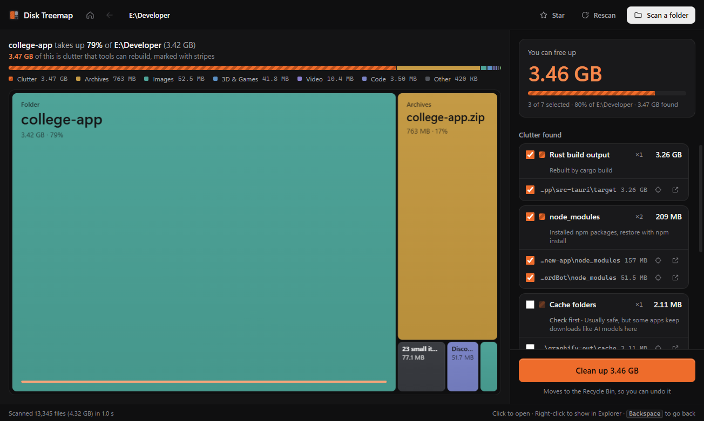
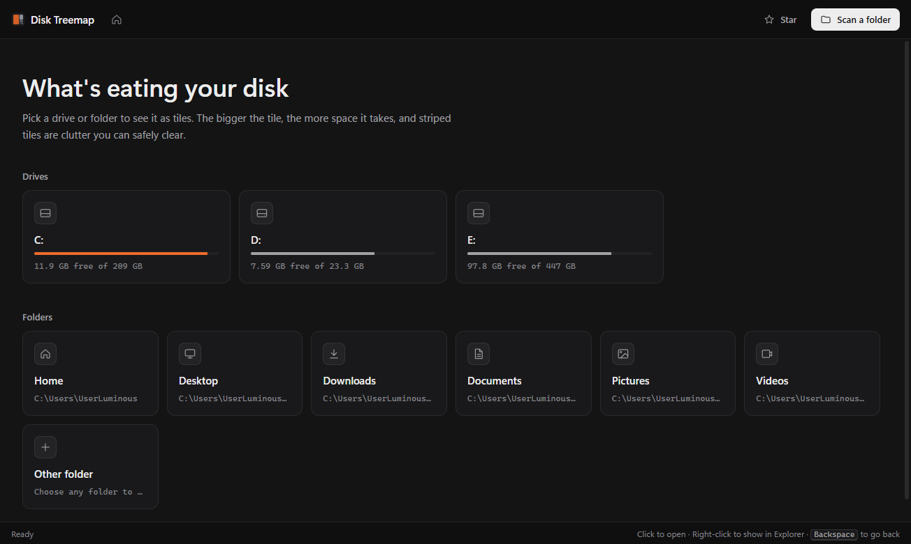

<p align="center"></p>

<h1 align="center">Disk Treemap</h1>

<p align="center"><b>See what's eating your disk, and clean up the clutter in one click.</b></p>

<p align="center">
  <a href="https://github.com/itslxmns/TreeMapDisk/releases/latest"></a>
  <a href="https://github.com/itslxmns/TreeMapDisk/stargazers"></a>
  
  
</p>

> **If Disk Treemap saved you some space, please put a star on this repo** (the Star button at the top right of this page). It's free and helps other people find the app.

Disk Treemap shows any drive or folder as big tiles: **bigger tile = more space**. It spots stuff that dev tools can rebuild (`node_modules`, Python caches, `.next`, Rust `target/`, .NET `bin/obj`…), tapes it off with orange hazard stripes, and lets you send it to the **Recycle Bin** with one button.



## Features

- **One level at a time**: about 36 big tiles max, with the long tail grouped into one "small items" tile. Click a folder to zoom in, press `Backspace` (or the mouse back button) to zoom back out.
- **Summary in plain words**: "node_modules takes up 87% of DiscordBot", plus a color bar showing what the folder is made of (video, images, code, clutter…).
- **Tooltips**: hover any tile to see its size, its share of the folder, its file count and what's inside.
- **Clutter detection that uses context**: `target/` only counts next to a `Cargo.toml`, `bin/obj` only next to a `.csproj`. Clearly safe items are pre-selected, and risky ones (`dist`, `.venv`, `.cache`, `Temp`, `.git`) are marked "check first" and opt-in.
- **Never deletes for real**: everything goes to the Recycle Bin after a confirmation that lists exactly what will be moved.
- **Home screen**: drive cards with free-space bars, plus one-click quick folders (Downloads, Documents, Desktop…).
- **Fast**: scanning runs in a worker thread with live progress (about 11,000 files per second on an SSD). Symlinks and junctions are skipped, so nothing is counted twice.



## Download & install (Windows)

Grab one of these from the [latest release](https://github.com/itslxmns/TreeMapDisk/releases/latest):

| File | What it is |
|---|---|
| `DiskTreemap-Setup-1.0.1.exe` | Installer: one click, no admin needed. Adds Desktop and Start menu shortcuts. |
| `DiskTreemap-1.0.1-portable.exe` | Portable: just double-click it, nothing gets installed. |

> The builds aren't code-signed, so Windows SmartScreen may say "Windows protected your PC". Click **More info → Run anyway**.

## What it detects

| Group | Folders | Pre-selected |
|---|---|---|
| node_modules | `node_modules` | |
| Python caches | `__pycache__`, `.pytest_cache`, `.mypy_cache`, `.ruff_cache`, `.tox` | |
| JS framework caches | `.next`, `.nuxt`, `.parcel-cache`, `.turbo`, `.svelte-kit`, `.angular`, `.vite`, `.expo` | |
| Gradle caches | `.gradle` | |
| Rust build output | `target` (next to `Cargo.toml`) | |
| .NET bin / obj | `bin`, `obj` (next to a `.csproj`/`.fsproj`/`.vbproj`) | |
| JS build output | `dist`, `build`, `out`, `.output` (next to `package.json`) | — |
| Python virtualenvs | `.venv`, `venv` | — |
| Cache folders | `.cache`, `cache`, `caches` | — |
| Temp folders | `temp`, `tmp` | — |
| Git history | `.git` | — |

The rules live in [`src/junk.js`](src/junk.js). Adding one takes a single object.

## Build from source

Requires [Node.js](https://nodejs.org/) 18 or newer.

```bash
git clone https://github.com/itslxmns/TreeMapDisk.git
cd TreeMapDisk
npm install
npm start          # run in development
npm run dist       # build the installer + portable .exe into release/
npm run icon       # regenerate src/assets/icon.png
```

Dev helper: scan on launch, save a screenshot, and quit:

```bash
npx electron . --scan=D:\Projects --screenshot=docs/screenshot.png
```

## How it works

```
src/
├── main.js        Electron main process: window, IPC, drive info, Recycle Bin + confirmation
├── preload.js     Exposes a small API to the page (contextIsolation + sandbox)
├── scanner.js     Worker thread: walks the disk and builds a compact size tree
├── junk.js        Rules for regenerable folders
├── assets/        App icon (drawn by scripts/make-icon.js)
└── renderer/      UI: canvas treemap, zoom animation, story header, cleanup sidebar
```

- The layout uses the **squarified treemap** algorithm, so tiles stay as close to square as possible.
- Each folder keeps per-category byte totals, which power the "made of" bar and each tile's color (a folder takes the color of what it mostly contains).
- Sizes are apparent file sizes (like Explorer's "Size").

## Support the project

If you like Disk Treemap, the easiest way to help is to **[star the repo](https://github.com/itslxmns/TreeMapDisk)**. Bug reports and ideas are welcome in [Issues](https://github.com/itslxmns/TreeMapDisk/issues).

## License

MIT
